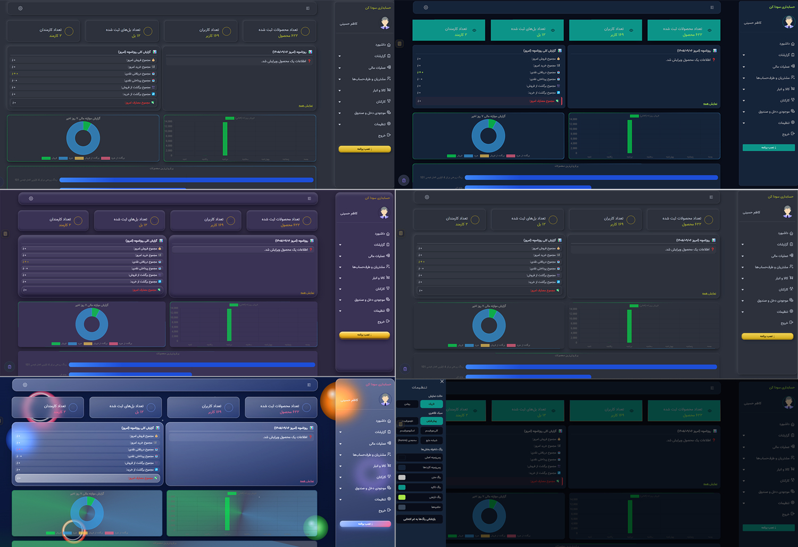
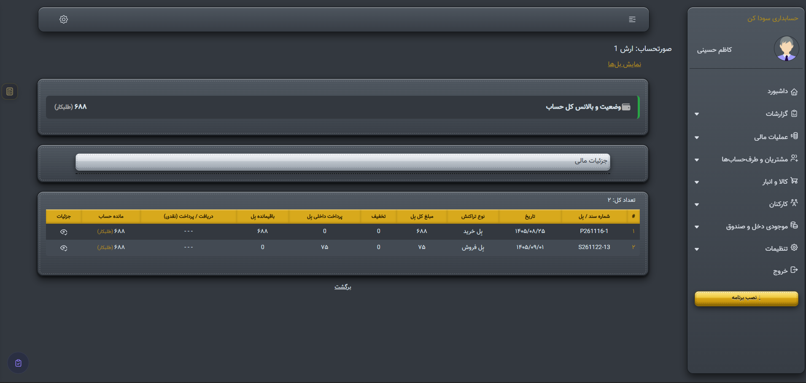
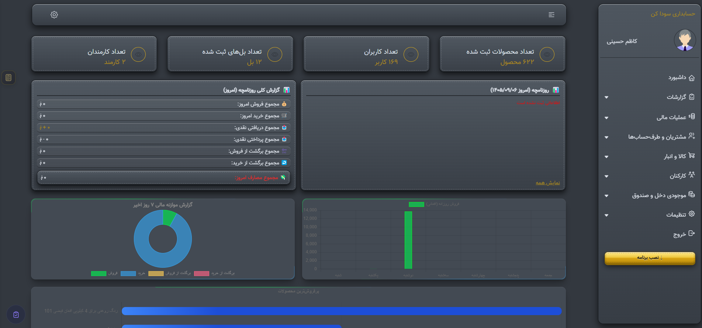
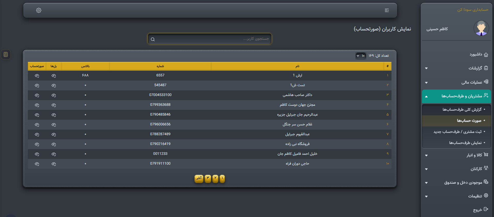
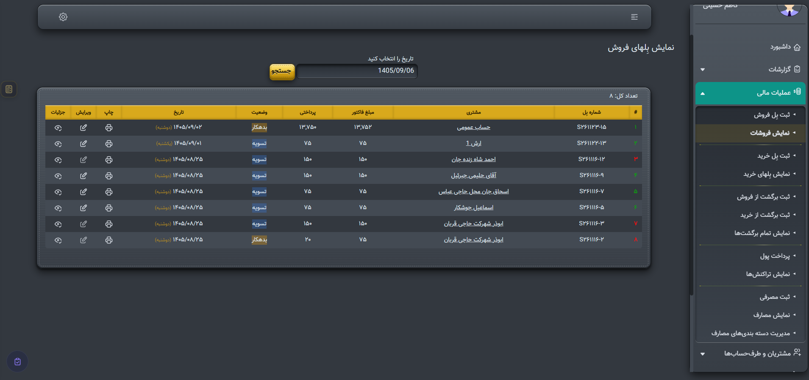
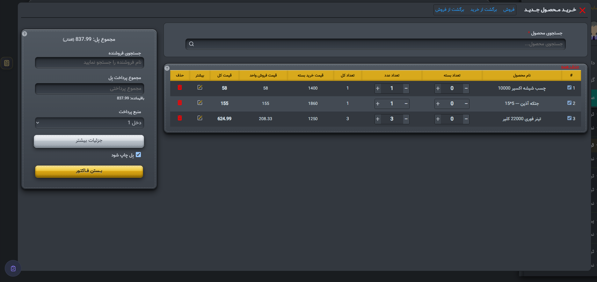
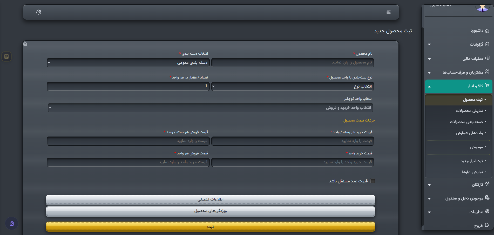
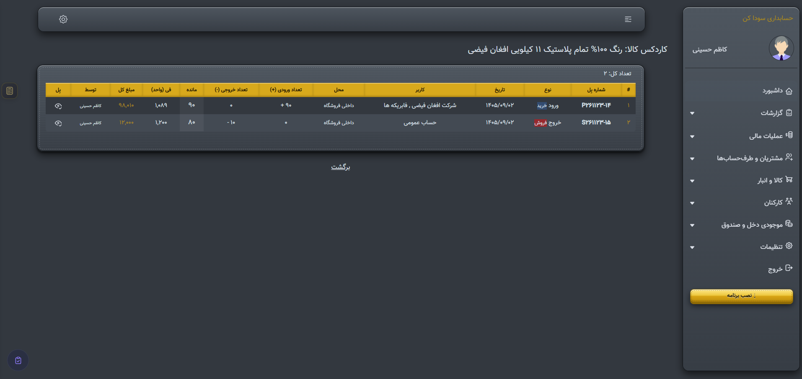
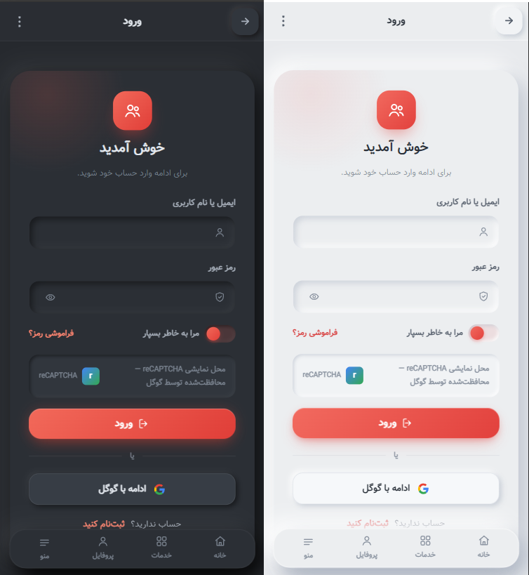

# Enterprise Accounting & Business Management System

A modular, multi-company business management and accounting platform designed to manage financial operations, sales, purchasing, inventory, employees, and business activities through a unified system.

The platform is fully operational and currently used by customers. It is built around a custom PHP MVC backend, a MySQL database, and a responsive user interface with customizable visual themes.

> **Portfolio Notice:** This repository contains documentation and selected screenshots for portfolio purposes only. The original source code is proprietary and is not publicly available.

## Overview

The system is designed as a comprehensive business management solution rather than a basic accounting application.

It supports multiple companies and branches, role-based user access, financial workflows, inventory operations, employee management, and configurable reporting.

Its modular architecture makes it possible to extend existing functionality and introduce new modules without redesigning the entire application.

## Key Features

## Multilingual Support

The application features a multilingual user interface with support for three languages:

- **Persian (فارسی)**
- **English**
- **Pashto (پښتو)**

Users can interact with the application in their preferred supported language.

The application screenshots in this repository are captured from the Persian-language interface. They demonstrate the actual product UI and its functionality.

The multilingual interface is an integrated feature of the application, not a separate demonstration or prototype.

### Multilingual Interface
- Multi-language user interface
- Support for different language environments
- Persian-language interface currently demonstrated in the portfolio screenshots
- Persian, English, and Pashto language support
- Multilingual application interface
- Designed for users with different language preferences

### Accounting & Financial Management
- Double-entry and simplified accounting workflows
- Financial transactions and account management
- Customer accounts and financial records
- Receivables and payables management
- Financial statements and reports
- Sales and purchase management

### Multi-Company & Multi-Branch Management
- Support for multiple companies
- Multi-branch organizational structure
- Centralized management of business operations
- User access management across the system

### Employee Management
- Employee records and administration
- Role-based access and permissions
- Salary and payroll management
- Employee receivables and payables
- Attendance management

### Inventory & Business Operations
- Inventory management
- Purchasing and sales workflows
- Integrated financial and operational records
- Business activity reporting

### Customizable User Interface
- Six built-in visual design themes
- Includes Neumorphism, Glassmorphism, and Claymorphism styles
- User-configurable colors for different sections
- Custom-designed interface components
- Responsive layouts for desktop and mobile devices

### Mobile PWA for Managers
- Progressive Web App (PWA) experience
- Mobile-oriented interface based on the main application's design system
- Dedicated navigation buttons
- Simplified mobile layouts
- Removal of unnecessary desktop-oriented components
- Designed to provide managers with convenient access to important system functions

## Technical Architecture

| Layer | Technology |
|---|---|
| Backend | PHP |
| Backend Architecture | Custom MVC |
| Frontend | JavaScript, jQuery |
| Navigation | Swup |
| Database | MySQL |
| Mobile Experience | Progressive Web App (PWA) |
| UI | Custom-designed interface |

### Architecture Highlights

- Modular PHP MVC architecture
- Extensible backend structure
- Separation of application components
- Custom frontend implementation
- MySQL-based data management
- Swup-powered page transitions for a smoother, app-like navigation experience
- Shared design foundation between desktop and mobile interfaces

## Product Status

**Production Status:** Operational and currently used by customers.

This is an actively used software product, not just a prototype or demonstration project.

## Screenshots

### Available Interface Themes

The following image demonstrates the six visual themes available in the application.

### Customer Account Interface

An example of the customer account interface.

## Project Information

- **Project Type:** Enterprise Business Management Software
- **Architecture:** Custom Modular PHP MVC
- **Database:** MySQL
- **Frontend:** JavaScript and jQuery
- **Mobile:** Progressive Web App
- **Development:** Designed and developed independently

## Source Code

## Application Screenshots

### Dashboard

### UI Themes

### Customer Management

<!-- 
### Accounting
 -->

### Sales

### Purchasing

### Inventory

### Reports

### Mobile PWA

The original application source code is proprietary and is not included in this repository.

This repository is intended to document the product's capabilities, architecture, and selected interface examples.
